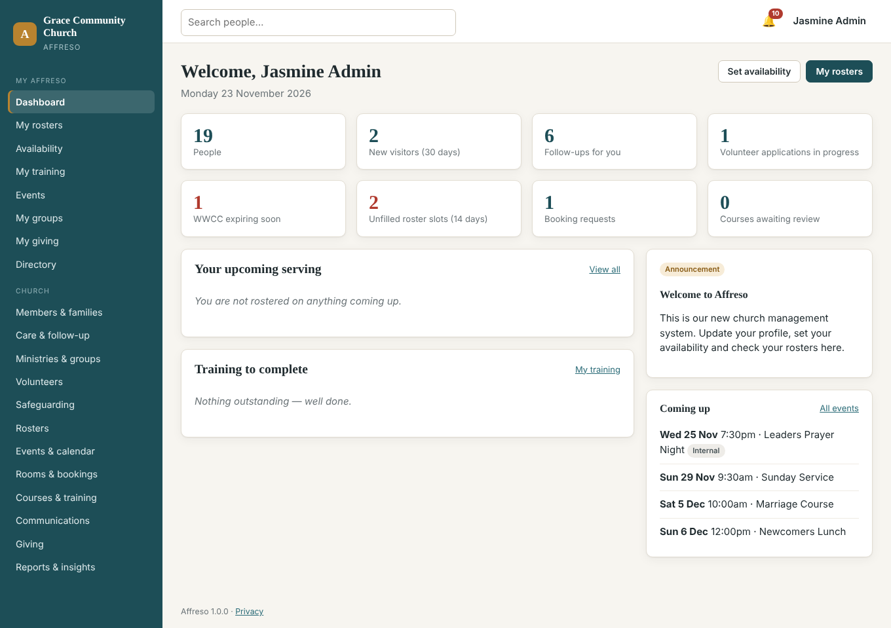

# Affreso — Church Management System

**One secure system for church leaders, administrators, members and volunteers.**

[Website](https://affreso.com) · [Live demo](https://demo.affreso.com) · [Download](https://affreso.com/download/) · [Tutorials](https://affreso.com/tutorials/) · [FAQ](https://affreso.com/faq/)



Affreso is a self-hosted church management system. Each church downloads it, uploads it to its own web hosting, and runs it on its own domain. Your church's data stays on your server.

It runs on ordinary shared hosting: **PHP 8.1+ and MySQL 5.7+ / MariaDB 10.3+**. You don't need Composer, Node.js or a build step.

---

## What's included

| Module | Highlights |
|---|---|
| **Members & Families** | Profiles, households, membership status, custom fields, CSV import/export, opt-in member directory |
| **Pastoral care** | Encrypted confidential pastoral notes with restricted access and view logging. Care tasks for newcomers, pastoral contact, baptism, membership and prayer |
| **Events & Calendar** | Month calendar, public and internal events, registrations, capacity, automatic waiting lists, attendance, joining-instruction emails |
| **Bookings** | Rooms and equipment with clash detection and an approval workflow |
| **Volunteer Rosters** | Positions, availability and blockout dates, suggested volunteers, overlap detection, burnout flags, accept/decline, swap requests, leader approval before publishing, reminders |
| **Volunteer onboarding** | Apply → review → training assigned → training completed → leader approves → rostering, all connected |
| **Safeguarding** | WWCC / Blue Card / Ochre Card records (numbers encrypted), expiry alerts, automatic removal from child-related rosters when a check expires or is barred |
| **Courses & Training (LMS)** | Courses with text, video, PDF and Bible-passage lessons, plus quizzes. Draft → review → publish workflow, prerequisites, certificates with public verification, renewal periods |
| **Communications** | Targeted email and SMS (ClickSend or Twilio), merge fields, opt-out and consent respected, delivery log, dashboard announcements |
| **Ministries & Groups** | Teams, small groups and ministry areas, leaders, open groups people can join, meeting attendance |
| **Giving** | Stripe Checkout online giving, manual donations, funds, email receipts, financial-year statements |
| **Reports & Insights** | Membership, volunteer participation, roster coverage, training and child-safety compliance, events, groups and giving. Every report exports to CSV |
| **Administration** | Granular roles and permissions, two-step verification (TOTP), full audit log, settings, scheduled tasks |
| **Privacy & compliance** | Consent records, self-service data download, privacy request register, retention review, Notifiable Data Breach register |
| **Public pages** | Events list and registration, a digital connect card for newcomers, online giving, iCal feeds, certificate verification, privacy policy |
| **Member self-service** | "My Affreso": profile, rosters, availability, training, groups, events, giving history, privacy choices, volunteering |

**New in version 4.3**

| Feature | Highlights |
|---|---|
| **Refunds for gifts** | Refund all or part of a gift from the giving list: back to the card for online gifts, or recorded for cash and bank gifts (and mistakes). Giving statements, reports and campaign totals show only what the church kept, and the donor is told by email. Refunds made in the Stripe dashboard are picked up automatically. |
| **Ticket types and family tickets** | Forms can sell several kinds of ticket (Adult, Child, Family…), each with its own price and the number of places it uses. People choose quantities and see the total as they go; places limits, instalments and the linked event's list all use the real headcount. |

**New in version 4.2**

| Feature | Highlights |
|---|---|
| **Refunds** | Refund a form response from Affreso: back to the card through Stripe (split across instalments if needed), or recorded as cash or bank. Cancel the response at the same time, or keep it and lower the amount owed for a discount. Refunds made in the Stripe dashboard are picked up too. |
| **Paid events** | Link a form to an event and it becomes the event's registration, with a price, instalments, a places limit and extra questions. Confirmed responses appear in the event's registration list, and cancelled or refunded ones drop off it. |

**New in version 4.1**

| Feature | Highlights |
|---|---|
| **Pay in instalments** | Paid forms can let people spread the cost over 2–12 monthly payments. Stripe takes the first payment straight away and the rest monthly, and Affreso stops the plan after the last one. Staff see each payment, can record cash or bank transfers, and can stop a plan early. |
| **Form answers into profiles** | Link a question to a profile field (mobile, address, date of birth, member since, or any custom field). Staff choose whose profile to update from each response — the parent who filled it in or the child going to camp — and see exactly what will change first. A form can also update a signed-in member's own profile automatically. |
| **Arabic and Persian labels** | Check-in labels printed through PrintNode now shape and order Arabic-script names correctly. |

**New in version 4.0**

| Feature | Highlights |
|---|---|
| **Online forms builder** | Build sign-up and enquiry forms (camps, baptisms, hall hire and anything else) from short and long answers, choices, drop-downs, dates, numbers, consent boxes and headings. Forms can be public or members-only, with open and close dates, a places limit, one response per person and optional card payment through Stripe. Answers are encrypted, staff get a link rather than the answers by email, and responses export to CSV. |
| **Pledges & campaigns** | Building funds and appeals with a goal, dates and a giving fund. People pledge online (or staff record pledge cards), progress comes straight from gifts to the fund, each pledger sees how they are tracking, and staff can email everyone their progress. Anonymous pledges are supported. |
| **Pre-check-in from the phone** | Parents check their children in from My Affreso → My children before they leave home and get a six-character arrival code. The welcome desk sees the family as expected, and labels print as soon as they arrive at the desk or kiosk. |
| **Direct label printing** | Silent printing straight to a Brother QL, DYMO or other label printer through PrintNode, with no print dialog. Labels are rendered on the server as PDFs at 300 dpi, long names wrap, and you can upload a font for Chinese, Korean or Japanese names. Each kiosk can use its own printer, and printing from the browser still works as a fallback. |
| **More languages** | Vietnamese, Arabic and Persian join Simplified Chinese, Traditional Chinese and Korean. Arabic and Persian use a right-to-left layout. |

**New in version 3.0**

| Feature | Highlights |
|---|---|
| **Repeating events** | Weekly, fortnightly, monthly by date, or monthly by weekday (e.g. 2nd Sunday). Edit one date, or this and all following dates. Rooms are booked for every date, and new dates are added automatically each night. |
| **Attendance headcounts** | Adults, youth, children, online and first-time visitors for each service and campus. Children checked in are counted for you. Includes a weekly trend chart, averages, a comparison with last year and a CSV export. |
| **Self check-in kiosk** | A tablet at the door where parents check their own children in with their mobile number. Matching codes and labels print automatically. The screen shows first names and initials only, and lookups are rate-limited. Pairing uses a one-time code, and leaving kiosk mode needs a staff PIN. |
| **Two-way calendar sync** | People connect Google Calendar or Microsoft 365 / Outlook. Their rosters and events are added automatically, and leaders see "busy in their calendar" when rostering (times only, never details). |
| **Direct import** | Bring people, families and groups across from Elvanto or Planning Center in one step with an API key, which is never stored. Imports are safe to re-run. |
| **Phone notifications with content** | Notification titles are encrypted end to end (RFC 8291), so they show straight away on locked phones. Can be switched off. |
| **Translations** | Simplified Chinese, Traditional Chinese and Korean are included, with dates in each language's own format. |

**New in version 2.0**

| Module | Highlights |
|---|---|
| **Children's check-in** | Family search by surname or mobile, age-based classes, matching security codes, printed child labels and parent tags, authorised and *not-permitted* collectors, allergy and medical alerts (encrypted), leader ratios with a two-adult minimum, and leaders only counted if their WWCC is current. Parents keep their own children's care details up to date. |
| **Incident reporting** | Anyone can report, with encrypted details. Child-safety reports alert safeguarding officers straight away. Includes a review workflow, reportable-conduct flag, and dates for notifying police, child protection, regulator and insurer. |
| **Service planning** | Orders of service with running times, songs with keys and CCLI numbers, the people rostered that day, printable run sheets, copy-to-next-week, and a CCLI usage report. |
| **Resource library** | Handbooks, policies and studies with version history and visibility by role or group. |
| **Policy acknowledgements & e-signatures** | Typed name plus an optional drawn signature, a fingerprint of the exact version signed, IP address and time, and a printable signing record. Policies can be required for serving positions, so unsigned volunteers can't be rostered. Re-signing is required when a policy changes. |
| **Reimbursements** | Claims with receipt photos and encrypted bank details. The ministry leader approves (never their own claim), then the treasurer pays. Exports an ABA bank file and a Xero bills CSV. |
| **Regular giving & statements** | Weekly, fortnightly or monthly Stripe gifts that donors can cancel themselves, financial-year giving statements (print or email), bank CSV import that matches donors by giving number or name, and Xero and MYOB exports. |
| **Prayer** | Requests at three privacy levels (church, prayer team, pastors), "I prayed" counts, answered-prayer updates, and a public prayer form. |
| **Multi-campus** | Campuses for people, groups, events, rosters, rooms and check-in. Staff can switch campus, and accounts can be limited to one campus. |
| **Languages** | A language choice for each person, right-to-left layouts (Arabic, Persian, Hebrew) and dates shown in the local language. |
| **Installable app** | Add to the home screen on iPhone or Android, with an offline page and push notifications for rosters and messages. No church data is stored on the device. |
| **Integrations** | Mailchimp audience sync (respects consent and unsubscribes), import from Elvanto and Planning Center exports, Xero and MYOB CSV exports, and ABA bank files. |
| **Accessibility** | Every page tested with axe-core against WCAG 2.1 AA. See [docs/ACCESSIBILITY.md](docs/ACCESSIBILITY.md). |

**Upgrading from an earlier version:** upload the new files over the old ones, keeping `config/` and `storage/`. The database upgrades itself on the next page load. See [CHANGELOG.md](CHANGELOG.md).

## Quick start

1. Upload the `affreso` folder to your web hosting, for example `public_html/affreso`.
2. Create an empty MySQL database and user in your hosting control panel.
3. Visit `https://your-church.org.au/affreso/` and follow the installer.
4. Sign in, set up two-step verification, then go to **Administration → Settings** to connect email, SMS and Stripe.
5. Add the scheduled task (cron) shown in **Settings → Scheduled tasks**.

You'll find full instructions in **[docs/INSTALL.md](docs/INSTALL.md)**.

## Demo site

Tick **"Make this a public demo site"** in the installer to get one-click role sign-ins, a demo banner, email, SMS and payments switched off, and a nightly reset to fresh sample data. See [docs/INSTALL.md](docs/INSTALL.md#13-setting-up-a-public-demo-site).

## Documentation

- [docs/INSTALL.md](docs/INSTALL.md): installation, hosting, cron, upgrades, backups
- [docs/USER-GUIDE.md](docs/USER-GUIDE.md): how each role uses Affreso
- [docs/SECURITY.md](docs/SECURITY.md): the security model and hardening checklist
- [docs/PRIVACY-COMPLIANCE.md](docs/PRIVACY-COMPLIANCE.md): Australian privacy and child-safety support, and what you must verify
- [docs/TRANSLATING.md](docs/TRANSLATING.md): adding interface languages
- [docs/ACCESSIBILITY.md](docs/ACCESSIBILITY.md): accessibility statement
- [docs/ROADMAP.md](docs/ROADMAP.md): what's next
- [CHANGELOG.md](CHANGELOG.md): version history

## Folder structure

```
affreso/
├── index.php            Front controller (all pages)
├── cron.php             Scheduled tasks
├── .htaccess            Apache rules (blocks access to private folders)
├── app/                 Application code (controllers, views, libraries)
├── assets/              CSS, JavaScript, QR-code library
├── config/              config.php is created by the installer (keep private)
├── database/          Database structure and automatic upgrades (migrations/)
├── sw.js                Installable-app service worker
├── lang/                Translations
├── storage/             Uploaded files and logs (keep private)
├── tools/               Command-line helpers
└── docs/                Documentation
```

## Important

Legal requirements vary by state, territory and organisation. Before you go live, check Affreso's privacy, child-safety, retention and giving-receipt features against your obligations with your denomination, insurer or a lawyer. Read [docs/PRIVACY-COMPLIANCE.md](docs/PRIVACY-COMPLIANCE.md).

Third-party code: `assets/vendor/qrcode.js` is the QR Code Generator by Kazuhiko Arase (MIT licence). It draws the two-step verification QR code inside the browser.

## Contributing

Bug reports, translations and pull requests are welcome. Read [CONTRIBUTING.md](CONTRIBUTING.md) first. Please report security problems privately, as described in [SECURITY.md](.github/SECURITY.md), not in a public issue.

## Licence

Affreso is free software: you can redistribute it and/or modify it under the terms of the GNU General Public License as published by the Free Software Foundation, version 3 of the License (GPL-3.0). It is distributed in the hope that it will be useful, but WITHOUT ANY WARRANTY. See [LICENSE](LICENSE) for the full text.

Copyright © 2026 Affreso contributors.
